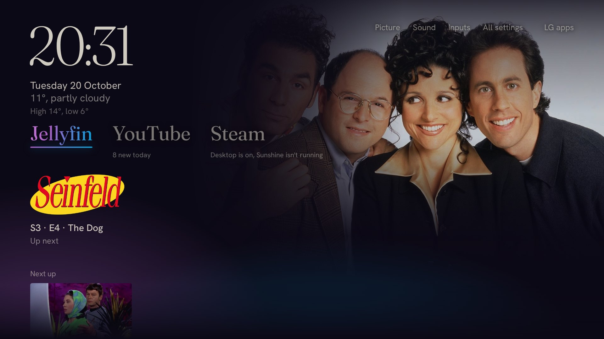
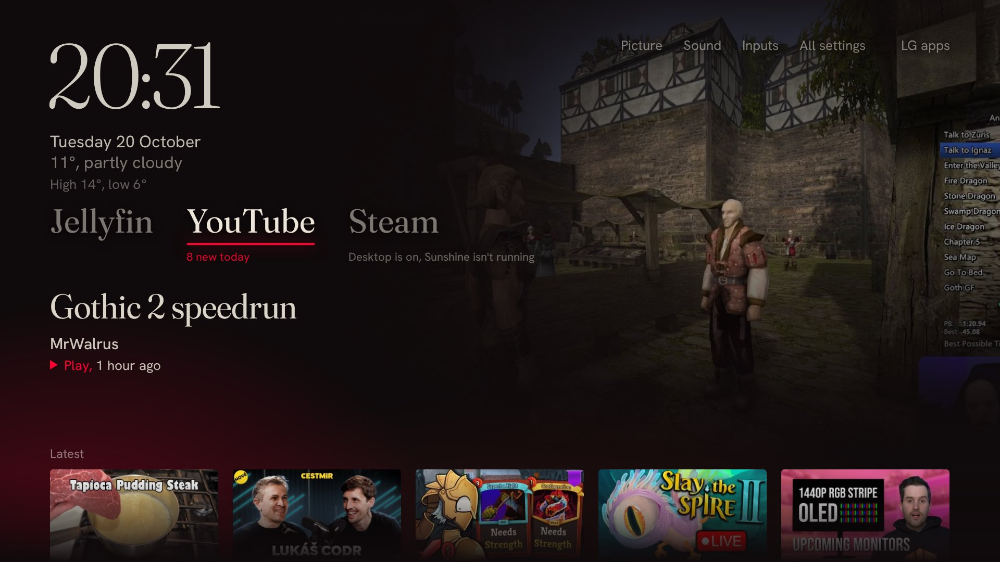
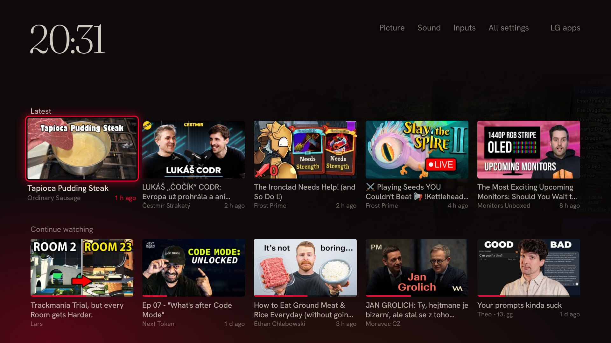
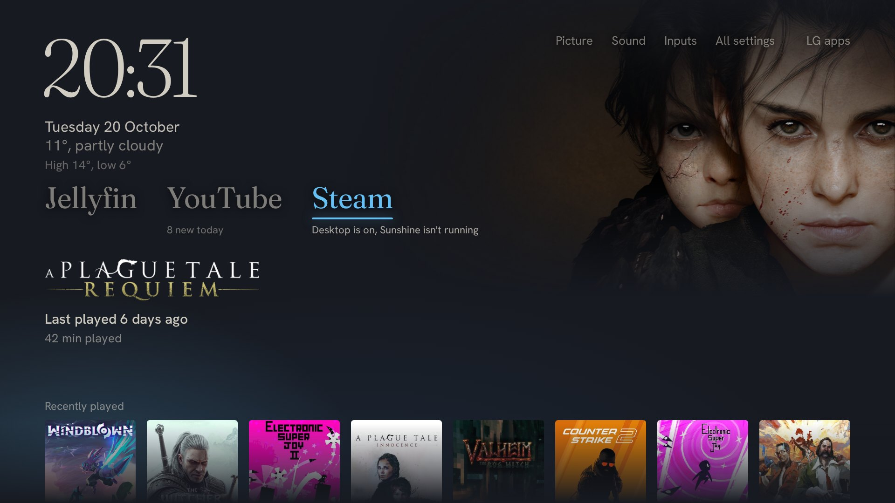
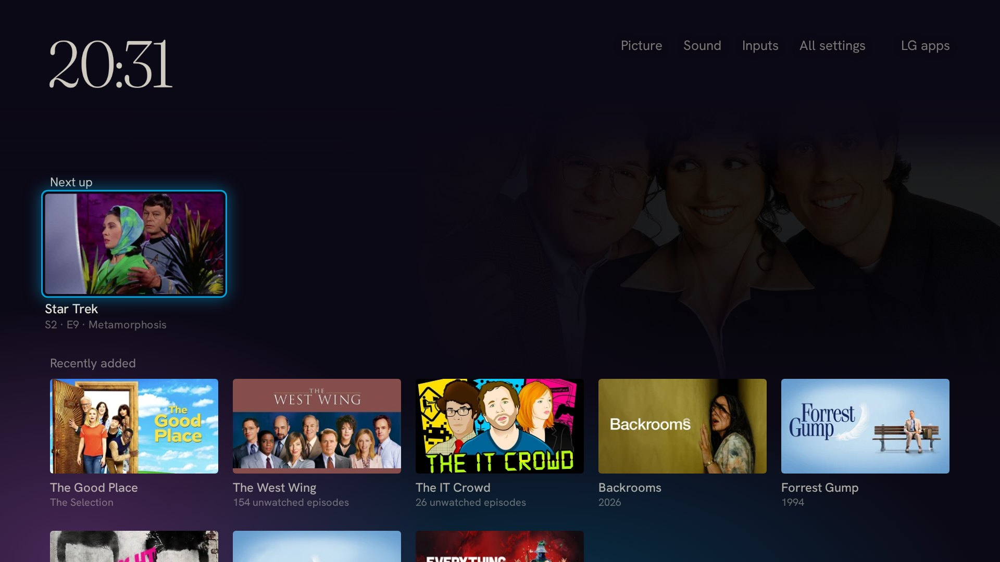

# TV Home

A custom home screen for LG webOS TVs. It replaces LG's launcher with a calm,
remote-friendly page that shows what you actually watch and play, and opens
the right app in one press.

## Start here: pick a version

- **No computer that stays on? Use the TV-only version.** One app, no server:
  download the `.ipk` from the
  [latest release](https://github.com/Hajadlo/lg-tv-home/releases/latest),
  install it in Developer Mode and set it up on the TV with the remote.
  Steps: [lite/README.md](lite/README.md).
- **Have an always-on machine (home server, NAS, Raspberry Pi)? Use the server
  version** for the full experience: Home button takeover, watched videos
  hidden, Continue watching, automatic Developer Mode renewal. Hand
  [SETUP.md](SETUP.md) to a coding agent running on that machine.

Not sure? See [Three ways to run it](#three-ways-to-run-it) below.

## What it does

- **Apps as tabs.** Across the top sit the "doors": Jellyfin, YouTube and
  Steam. Moving onto a door shows that app's content below it; Enter opens
  the app. Up from any row brings you back to the same tab. Only the apps you
  set up get a tab.
- **Takes over the Home button.** When the TV turns on, TV Home is the first
  thing on screen. Optionally the remote's Home button opens it too; "LG apps"
  still reaches LG's own launcher.
- **Jellyfin.** Continue watching, Next up and Recently added from your
  Jellyfin server. Picking an episode opens the Jellyfin app and starts that
  episode through Jellyfin's remote control.
- **YouTube without ads.** New videos from your subscriptions, played in
  YouTube AdFree (an ad-free YouTube app for webOS). Videos you have already
  watched (on any device) are left out, half-watched ones show a progress bar,
  and a Continue watching row picks up where you stopped. Streams on air get
  a red LIVE badge; finished streams and scheduled ones are left out.
- **Steam via Moonlight.** One press wakes your gaming PC, makes sure Sunshine
  is running, and opens Moonlight streaming Steam Big Picture. Recently played
  games are listed with their art.
- Also: clock, weather, shortcuts to Picture, Sound, Inputs and all settings,
  a slow slideshow when idle, and a small offline screen if the server is down.

## Screenshots

Taken from a real setup at 1920×1080, the TV's resolution.

| | |
|---|---|
|  |  |
| **YouTube:** the newest video from your subscriptions | **Latest** uploads and **Continue watching**, with progress bars |
|  |  |
| **Steam:** recently played games; Enter wakes the PC and opens Moonlight | **Jellyfin:** Next up and Recently added |

## Three ways to run it

What TV Home can do depends on what runs it. The server version and the
TV-only version are built; the rooted one is a written-up design. Details,
caveats and what is still unverified: [docs/editions.md](docs/editions.md).

| | TV only (Developer Mode) | TV + server (this repo) | Rooted TV |
|---|---|---|---|
| Status | **Built**: [lite/](lite/README.md), [download](https://github.com/Hajadlo/lg-tv-home/releases/latest) | **Built** | Design |
| Extra hardware | None | Always-on machine on the LAN | None |
| Home page, Jellyfin rows, YouTube uploads, Steam recents | Yes | Yes | Yes |
| Home button and power-on open TV Home | No (open it like an app) | Yes | Yes |
| YouTube follows your subscriptions automatically | No (fixed channel list) | Yes | No, unless a server is added |
| YouTube hides watched videos, Continue watching | No | Yes | No, unless a server is added |
| Steam: wake PC, fix Sunshine, open Big Picture | Wake and open, no Sunshine fix | Yes | Wake only |
| Developer Mode renewal | Automatic when TV Home opens | Automatic | Not needed |

## What you need (TV + server)

- **An always-on Linux machine on the same network as the TV** (a home
  server, NAS or Raspberry Pi-class box with Python 3.11+). It runs the TV Home
  server and a few small helpers.
- **An LG TV with webOS and Developer Mode** (free LG developer account).
  Developer Mode lets you install your own apps; it has to be renewed, which
  TV Home does automatically.
- **The apps you want on the TV:** Jellyfin, YouTube AdFree, Moonlight TV, as
  you like. YouTube AdFree and Moonlight TV are installed in Developer Mode
  too.
- For YouTube's watched state: a Firefox-family browser (Firefox, Zen,
  LibreWolf) somewhere on your network where you are signed in to YouTube.
- For Steam: a gaming PC with Sunshine and Wake-on-LAN.

## Setting it up

Setup takes a coding agent (Claude Code, Codex, ...) on the always-on machine
and you with the TV remote. Clone this repo there and **give `SETUP.md` to
your coding agent.** It checks your TV first (older webOS versions differ),
asks before anything that needs the remote, and never prints or commits your
keys.

## Layout

| Path | What |
|---|---|
| `server/` | The TV Home server (Python, no dependencies; Pillow optional) |
| `ui/` | The home page (static HTML/CSS/JS, served by the server) |
| `tv/` | The webOS app, installer, auto-launch watcher, Dev Mode renewal |
| `lite/` | The TV-only edition: one app, no server ([lite/README.md](lite/README.md)) |
| `systemd/` | User service templates and `install-units` |
| `config.example.toml` | Every setting, commented |
| `tests/`, `check.sh` | Tests; run `./check.sh` |

Try the page in a desktop browser without a TV or any sources:
`python3 server/tvhome_server.py --port 8811`, then open
`http://localhost:8811/?mock=1` (arrow keys and Enter work).

## License

MIT (see `LICENSE`). The fonts in `ui/fonts/` (Fraunces, Hanken Grotesk) are
under the SIL Open Font License; their license files sit next to them.
